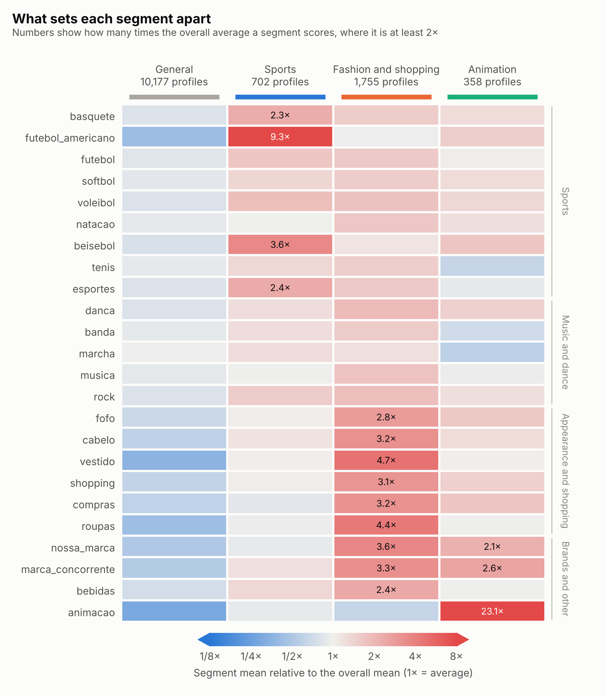
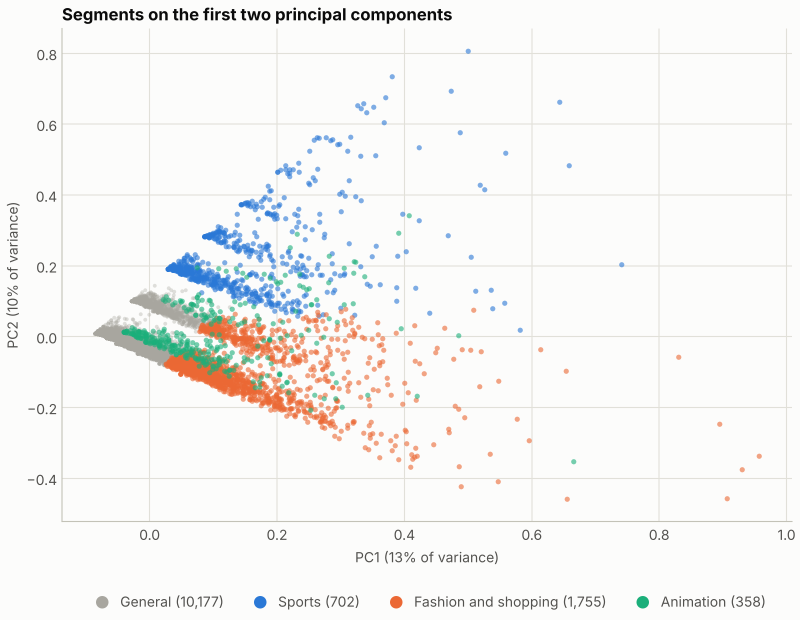
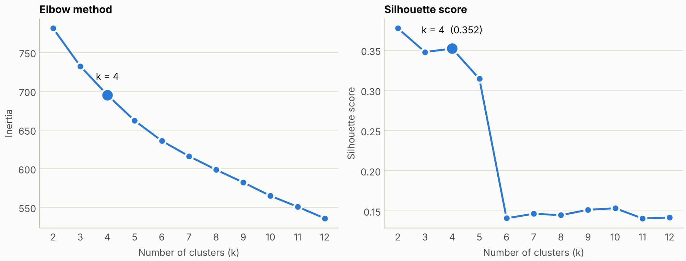
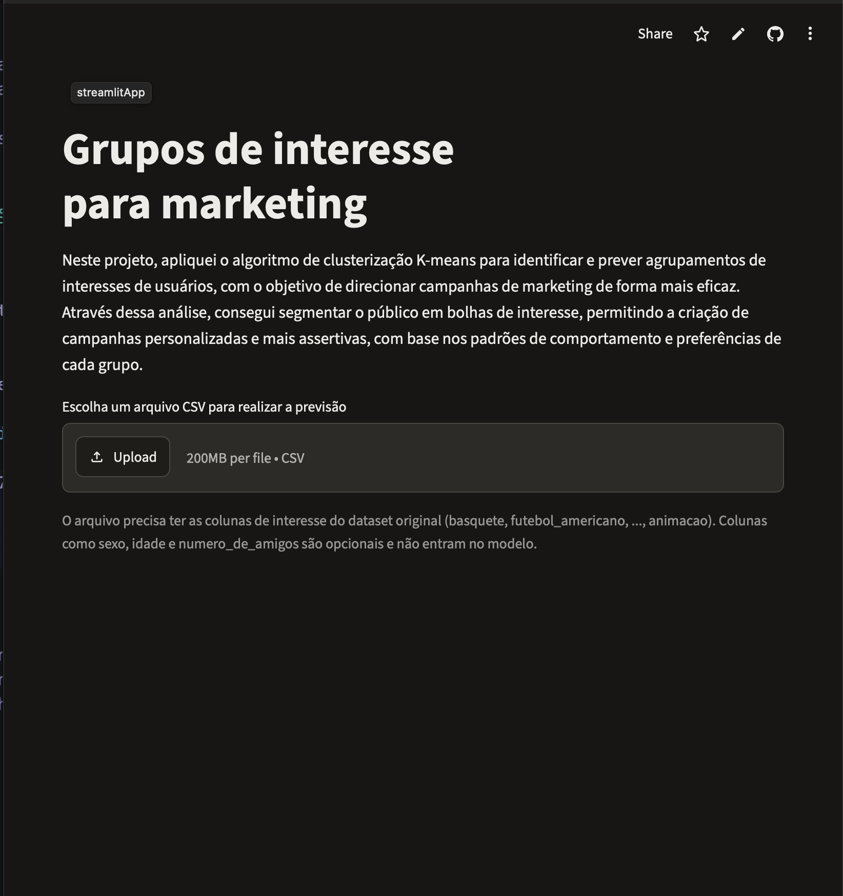

# Audience Segmentation with K-Means

Unsupervised learning project that groups social media profiles by interests, so marketing campaigns can be targeted at each segment. K-Means finds four segments in 12,992 profiles, and a small Streamlit app assigns new profiles to them from an uploaded CSV.



## Segments

| Segment | Profiles | Share | What stands out (times the overall average) |
| --- | --- | --- | --- |
| General | 10,177 | 78.3% | Below the overall average on 23 of the 24 interests |
| Sports | 702 | 5.4% | `futebol_americano` 9.3x, `beisebol` 3.6x, `esportes` 2.4x, `basquete` 2.3x |
| Fashion and shopping | 1,755 | 13.5% | `vestido` 4.7x, `roupas` 4.4x, `cabelo` 3.2x, `compras` 3.2x, and the highest scores on both brand columns (`nossa_marca` 3.6x, `marca_concorrente` 3.3x) |
| Animation | 358 | 2.8% | `animacao` 23.1x, with `marca_concorrente` 2.6x and `nossa_marca` 2.1x |

Sex was not used to build the segments, and the segments are not a proxy for it (adjusted Rand index of -0.04 against `sexo`). The mix still differs between segments, which comes from the interest patterns themselves:

| Segment | F | M | NE |
| --- | --- | --- | --- |
| General | 74.3% | 18.1% | 7.6% |
| Sports | 58.3% | 36.2% | 5.6% |
| Fashion and shopping | 91.0% | 3.3% | 5.7% |
| Animation | 91.1% | 0.8% | 8.1% |
| All profiles | 76.1% | 16.6% | 7.2% |

Age is practically the same across segments (26.6 to 26.9). The average number of friends goes from 30.0 (General) to 39.2 (Animation).



The two principal components capture 23% of the variance, so the segments overlap in this view. The Sports, Fashion and shopping and Animation segments each extend along their own direction, away from the dense General group.

## Dataset

`dados/dados_mkt.csv` contains 12,992 profiles and 27 columns, with no missing values. Column names are in Portuguese.

| Group | Columns |
| --- | --- |
| Demographics | `sexo` (F, M, NE), `idade`, `numero_de_amigos` |
| Sports | `basquete`, `futebol_americano`, `futebol`, `softbol`, `voleibol`, `natacao`, `beisebol`, `tenis`, `esportes` |
| Music and dance | `danca`, `banda`, `marcha`, `musica`, `rock` |
| Appearance and shopping | `fofo`, `cabelo`, `vestido`, `shopping`, `compras`, `roupas` |
| Brands and other | `nossa_marca`, `marca_concorrente`, `bebidas`, `animacao` |

Interest scores are sparse: 85% of them are zero.

## Approach

The full workflow is in [`notebooks/marketing_v2.ipynb`](notebooks/marketing_v2.ipynb).

1. **Features**: the 24 interest scores, scaled with Min-Max. `sexo`, `idade` and `numero_de_amigos` are left out (see below).
2. **Choosing k**: elbow method and silhouette score for k from 2 to 12, with 30 initialisations per fit. The silhouette stays around 0.35 for k=3 and k=4 (0.348 and 0.352), drops to 0.315 at k=5 and falls sharply from k=6. k=4 keeps the score of k=3 and separates one more segment with a distinct profile.
3. **Model**: a scikit-learn pipeline with `MinMaxScaler` and `KMeans(n_clusters=4, random_state=45, n_init=30)`.
4. **Profiling**: each segment mean is divided by the overall mean, so a value of 3x means the segment scores three times the overall average on that interest.
5. **Checks**: stability across random seeds, a PCA projection, and a comparison of the segments with sex.
6. **Deployment**: the pipeline, the feature list and the segment names are saved in a single file with `joblib`.



### Stability

K-Means can end in different local optima depending on the seed, so the model was refitted with different seeds and compared with the final result using the adjusted Rand index (ARI, where 1.0 means identical groups). For k from 2 to 5 the minimum ARI across five seeds is 0.981 or higher. From k=6 it drops (0.552 at k=6), which is another reason to stay at k=4. For the final model, the minimum ARI over ten seeds is 0.993.

### Why `sexo`, `idade` and `numero_de_amigos` are not features

The first version of the analysis ([`notebooks/marketing.ipynb`](notebooks/marketing.ipynb)) included one-hot encoded `sexo` in the features. Its three clusters turned out to be exactly the three values of `sexo`: after Min-Max scaling, the binary columns span the full 0 to 1 range while most interest scores stay close to 0, so they dominate the distance. The silhouette score of 0.745 reflects that, not the strength of the interest segments. Adding `idade` and `numero_de_amigos` also hurts: age barely varies (standard deviation of about 1.2 years) and the number of friends is heavy-tailed, with a maximum of 605.

| Features | Best silhouette score |
| --- | --- |
| Interests, age, friends and sex (v1) | 0.745 (k=3) |
| Interests, age and friends | 0.189 (k=5) |
| Interests only (v2) | 0.378 (k=2), 0.352 at the chosen k=4 |

Scores computed on different feature sets are not directly comparable. The point of the table is that the v1 score comes mostly from the sex columns.

## Streamlit app



The app (`app.py`) loads the saved model and lets you:

- upload a CSV with the 24 interest columns of `dados/dados_mkt.csv` (`sexo`, `idade` and `numero_de_amigos` are optional and ignored by the model)
- see an error message if columns are missing or contain non-numeric values
- preview the first 10 rows with the assigned segment and see how many profiles fall in each one
- download the full result as `Grupos_interesse.csv`

## Project structure

```
.
├── app.py                    # Streamlit app
├── dados/
│   └── dados_mkt.csv         # dataset
├── images/                   # charts and app screenshot used in this README
├── notebooks/
│   ├── marketing_v2.ipynb    # current analysis: interests only
│   ├── segmentation_v2.pkl   # model used by the app
│   ├── marketing.ipynb       # first version, with sexo as a feature
│   ├── encoder_sexo.pkl      # first version: fitted OneHotEncoder
│   ├── scaler.pkl            # first version: fitted MinMaxScaler
│   └── kmeans.pkl            # first version: fitted KMeans (k=3)
├── requirements.txt
└── README.md
```

## Getting started

Python 3.14 is the version the pinned dependencies were generated with.

```bash
git clone https://github.com/smacedo7/audience-segmentation-kmeans.git
cd audience-segmentation-kmeans

python -m venv .venv
source .venv/bin/activate   # Windows: .venv\Scripts\activate
pip install -r requirements.txt
```

Run the app:

```bash
streamlit run app.py
```

To go through the analysis, open `notebooks/marketing_v2.ipynb` in VS Code or JupyterLab and run it from the `notebooks` folder, since paths are relative to it. Running it again regenerates the charts in `images/` and `segmentation_v2.pkl`.

The `.pkl` files were generated with scikit-learn 1.9.1, so keep the pinned versions from `requirements.txt` to load them without warnings.

## Limitations and next steps

- A silhouette score of about 0.35 means moderate structure. Segments overlap, and most profiles fall into one diffuse segment. Interest scores come in steps of 10 and are mostly zero, which limits how cleanly K-Means can separate profiles.
- The choice of k=4 is a judgment call between similar silhouette scores. k=3 and k=5 are also reasonable.
- Next steps: try a log transform or a different scaler, compare against Gaussian Mixture Models or hierarchical clustering, and validate the segments against real campaign response.

## Tech stack

Python, pandas, NumPy, scikit-learn, matplotlib, seaborn, Streamlit, joblib.
